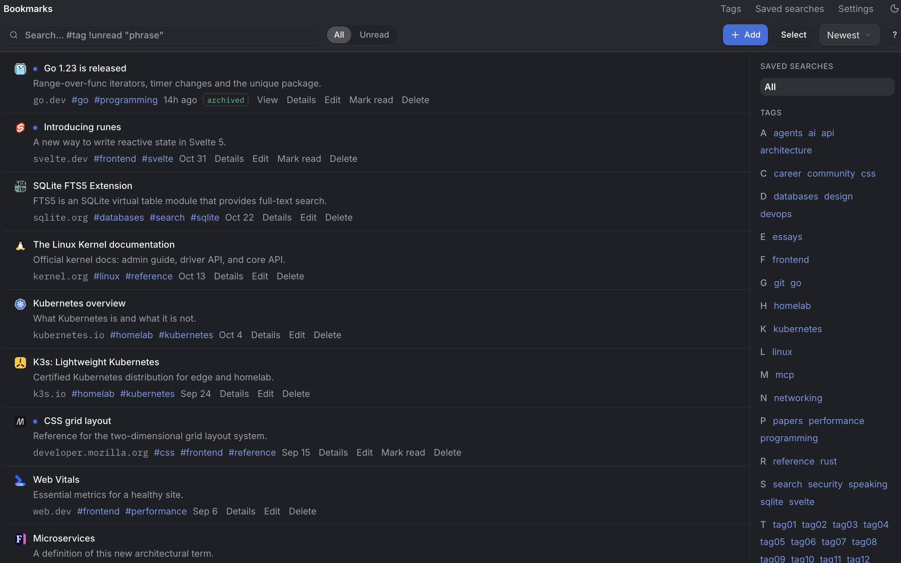

# Bookmarks

A bookmark manager.

- One Chrome extension saves the bookmark and a full-page archive
  (SingleFile-style) of the page as you see it.
- Every archive gets a stored reader-text version, indexed for full-text search.
- REST API and an MCP (`/mcp`) server, so agents can search and read your bookmarks.
- SQLite storage; one Go binary with the web UI embedded.



## Run

### Docker

```zsh
docker run -it \
  -p 127.0.0.1:8080:8080 \
  -v bookmarks-data:/data \
  -e BOOKMARKS_PUBLIC_URL=http://localhost:8080 \
  ghcr.io/danielfrg/bookmarks:latest
```

- Open [http://localhost:8080](http://localhost:8080)
- The SQLite database, previews and archives are stored in `/data`
- The container runs as UID/GID 65532

Published images support Linux AMD64 and ARM64. `latest` tracks `main`.

## Configuration

All settings are environment variables.

| Name | Default | Meaning |
| --- | --- | --- |
| `BOOKMARKS_ADDR` | `127.0.0.1:8080` | Address to listen on |
| `BOOKMARKS_DATA_DIR` | `./data` | Data directory; the database is `<DATA_DIR>/bookmarks.db` |
| `BOOKMARKS_PUBLIC_URL` | `http://127.0.0.1:8080` | Public origin of the app (no path) |
| `BOOKMARKS_MCP_ALLOWED_HOSTS` | unset | Extra comma-separated hostnames the MCP endpoint accepts (localhost is always allowed) |
| `BOOKMARKS_MAX_UPLOAD_MB` | `100` | Maximum uncompressed archive size, in MB |
| `BOOKMARKS_FAVICON_PROVIDER` | Google favicon service | Favicon URL template containing `{url}` |
| `BOOKMARKS_ALLOW_PRIVATE_FETCH` | `false` | Let the server fetch private/loopback addresses |

## Web UI

**Search syntax**

| Query | Meaning |
| --- | --- |
| `#tag` | Has the tag |
| `!unread` | Unread bookmarks |
| `!untagged` | Bookmarks without tags |
| `!basic` | Basic captures (no full archive) |
| `!noarchive` | Bookmarks with no archive at all |
| `"exact phrase"` | Phrase match |
| `foo and bar`, `foo or bar`, `not foo` | Boolean operators |

**Keyboard shortcuts** (on the list, with no dialog open; `?` shows them in the app)

| Key | Action |
| --- | --- |
| `n` | Add a bookmark |
| `s` or `/` | Focus search |
| `j` / `k` or `↓` / `↑` | Move the highlighted row |
| `Enter` or `o` | Open the highlighted link in a new tab |
| `v` | View details |
| `e` | Edit |

## Endpoints

- `/mcp`: MCP server (search and read bookmarks)
- `/api/docs`: interactive API documentation (OpenAPI at `/api/openapi`)
- `/healthz`, `/readyz`: health checks

## API tokens

Create API tokens in the web UI under **Settings → API**: give each app its own
named token (the Chrome extension, an agent).

## Development

Requires Go, Node, pnpm.

```sh
just install   # frontend dependencies
just api       # Go API on 127.0.0.1:8080
just frontend  # Vite dev server on 127.0.0.1:5173, proxies /api etc. to the API
```
